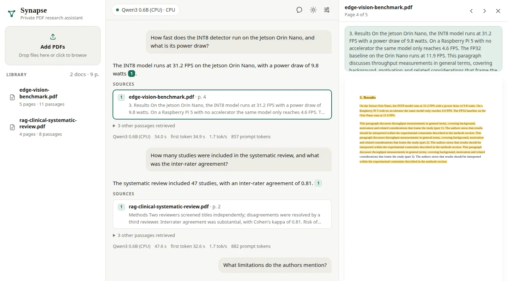

# Synapse: browser-native RAG over your PDFs

Ask questions about a set of PDFs and get answers with **clickable citations down to the page**.
PDF parsing, embeddings, vector search and the language model all run **inside the browser**.
There is no server and no API key, and documents are never uploaded.

**Live demo:** https://oscarcaux7.github.io/Browser-Native-Multi-Document-RAG-Engine-for-Systematic-Review/
(no PDF at hand? the demo has a *Try two sample papers* button with fictional documents)



## What it does

- **Drop PDFs** (several at once). Each one is parsed, split into passages and embedded in a background worker, with a progress bar per file. The UI stays responsive, even on a 180-page document.
- **Ask questions.** The answer streams token by token. Each claim carries a citation chip such as `[2]`.
- **Click a citation** to open the original PDF page, with the retrieved passage highlighted.
- **Literature overview**: a structured summary that compares all the documents in the library (built for systematic-review work).
- **It persists.** Model weights, PDFs and the vector index are cached in the browser, so a reload is ready in seconds without downloading anything again.
- Light and dark themes, phone layout, settings for the model, retrieval depth, temperature and answer length.

## How it works

```
 PDF ──► PDF.js text ──► page-aware chunks ──► embeddings ──► IndexedDB
                          (~900 chars, never     (transformers.js,
                           crosses a page)        WebGPU or WASM)
                                                       │
 question ──► query embedding ──► dense cosine top-40 ─┤
          └─► BM25 keyword top-40 ─────────────────────┴─► Reciprocal Rank Fusion ──► top-k passages
                                                                                          │
                       streamed answer with [n] citations ◄── local LLM (WebLLM on WebGPU) ◄┘
```

| Part | Implementation |
|---|---|
| UI thread | Vanilla ES modules, no framework and no build step. Hand-written CSS with light/dark tokens. |
| `rag-worker.js` | PDF.js 6.5 text extraction → sentence-aligned chunking → batched embeddings → hybrid search. Owns the index and IndexedDB. |
| `llm-worker.js` | The chat model, kept off the UI thread. **WebLLM 0.2.88** on WebGPU, or a **transformers.js 4.3** CPU fallback. Streams tokens back. |
| Retrieval | Dense vectors (L2-normalised, dot product) **plus BM25** fused with RRF, so exact terms such as model names and numbers are not lost. |
| Citations | Sources are numbered in the prompt. The model is told to cite `[n]`, and the answer is parsed and rendered as buttons linked to `{document, page, passage}`. |
| Storage | IndexedDB holds the PDFs and the chunks + vectors per embedding model. The Cache API holds model weights (managed by WebLLM and transformers.js). |

### Models

All model ids were checked against the WebLLM `prebuiltAppConfig` and the Hugging Face Hub.

| Role | Model | Download | Runs on |
|---|---|---|---|
| Chat (default) | Qwen3.5 2B (`Qwen3.5-2B-q4f16_1-MLC`) | ≈1.1 GB | WebGPU |
| Chat (light, phones) | Qwen3.5 0.8B | ≈0.45 GB | WebGPU |
| Chat (best) | Qwen3.5 4B | ≈2.4 GB | WebGPU (~3.9 GB VRAM) |
| Chat (alternatives) | Gemma 4 E2B, Llama 3.2 3B | 1.8–2.8 GB | WebGPU |
| Chat (fallback) | Qwen3 0.6B (`onnx-community/Qwen3-0.6B-ONNX`, q8) | ≈0.6 GB | CPU (WebAssembly) |
| Embeddings | BGE small en v1.5 (384-d, CLS pooling) | 35–65 MB | WebGPU, else WASM |

Reasoning ("thinking") mode is switched off for the Qwen models: short, grounded answers suit RAG better.
If the GPU lacks 16-bit float support, the f32 builds are picked automatically.
The 0.8B model is picked by default on phones and low-memory devices.

### Measured on a laptop (AMD Ryzen 7 / Radeon 780M iGPU, Chrome 157, Linux)

| What | Result |
|---|---|
| Index 2 short papers (9 pages, 19 passages), WebGPU embeddings | ≈1.6 s |
| Index a 180-page PDF (540 passages), WebGPU embeddings | 3.6 s; longest UI frame during indexing 17 ms (no freeze) |
| Reload with everything cached (library, index, chat model) | ready in ≈2–6 s, no network download |
| Qwen3.5 0.8B decode speed on the iGPU (WebGPU) | ≈22 tokens/s |
| CPU fallback (Qwen3 0.6B, WebAssembly, cross-origin isolated) | ≈3.4 tokens/s; ≈45 s for a cited answer from 4 passages |

On this particular Linux + AMD iGPU setup, WebGPU (still behind a flag on Linux) hit GPU driver resets on long prompts. Where that happens, the app restarts the model worker and reloads the model from cache instead of hanging.

## Run locally

ES modules and workers need an HTTP server (not `file://`):

```bash
python3 -m http.server 8000
# open http://localhost:8000
```

Unit tests for chunking, BM25/RRF, citation parsing and the Markdown renderer (Node 20+, no dependencies):

```bash
npm test
```

**Browser support.** The fast path needs WebGPU: Chrome/Edge 113+ on desktop, recent Chrome on Android, Safari 26+.
Without WebGPU the app still works on the CPU, but answers take noticeably longer.

## Project structure

```
index.html          app shell (semantic HTML, inline SVG icons)
css/app.css         design tokens, light/dark themes, responsive layout
js/main.js          UI controller: library, chat, streaming, settings
js/rag-worker.js    PDF parsing, chunking, embeddings, hybrid search, persistence
js/llm-worker.js    WebLLM (WebGPU) / transformers.js (CPU) chat back-ends
js/viewer.js        cited-page viewer with passage highlighting (PDF.js text layer)
js/chunker.js       text clean-up and page-aware chunking        (unit-tested)
js/retrieval.js     BM25, dense search, reciprocal rank fusion   (unit-tested)
js/prompt.js        prompt building and citation parsing         (unit-tested)
js/markdown.js      small, escape-first Markdown renderer        (unit-tested)
js/store.js         IndexedDB wrapper
js/config.js        pinned library versions and model catalogue
coi-sw.js           service worker adding cross-origin isolation (CPU-only devices)
samples/            two short fictional PDFs for the demo button
tests/              node:test unit tests
```

## Limitations

- Small local models can still misread or over-summarise. Citations exist so every claim can be checked against the page.
- Scanned PDFs without a text layer are rejected with a message; OCR is out of scope.
- The context window is 4k tokens, so only the top passages (6 by default) reach the model, and the literature overview reads the opening passages of each document (with many documents, only those that fit in the window).
- The first visit downloads the models (0.5–2.8 GB depending on the choice). Browsers may evict caches under storage pressure, so the app asks for persistent storage.
- The CPU fallback is slow: expect tens of seconds per answer. GitHub Pages cannot send the COOP/COEP headers that multi-threaded WebAssembly needs, so on devices without WebGPU a tiny service worker (`coi-sw.js`) adds them, with a single reload on the first visit.

## Acknowledgments

[WebLLM / MLC](https://github.com/mlc-ai/web-llm), [Transformers.js](https://github.com/huggingface/transformers.js), [PDF.js](https://mozilla.github.io/pdf.js/), and the Qwen, Gemma, Llama and BGE model authors.
